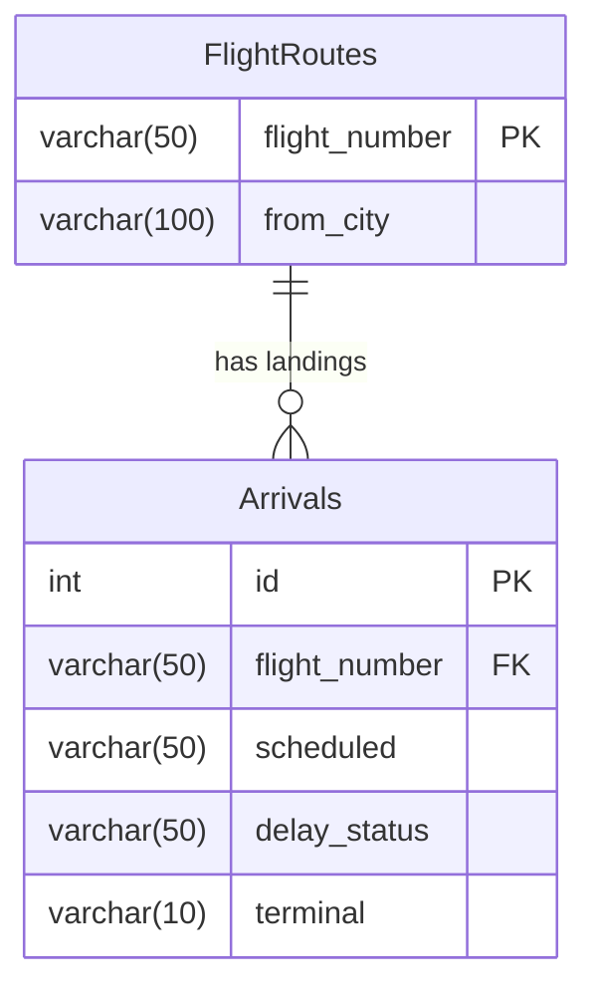

# Flight Arrivals Management System (`JDBC_FlightManager`)

**Course:** Software Engineering Methods (Academic Year 2026–2027)  
**Institution:** Braude College of Engineering | Department of Software Engineering  
**Database Engine:** MySQL 8.0+ | **Language:** Java 25 LTS (JDBC)

---

## 1. Project Description

This project implements a Java-based Data Access Layer (DAL) for an airport flight arrivals management system. Flight data was imported from `arrived_flights.csv` into a temporary MySQL table, `rawflights`, containing 299 arrival records. The data was then normalized into two related tables, `FlightRoutes` and `Arrivals`, to reduce repeated route information and improve consistency.

The project uses JDBC to connect Java applications to MySQL. `FlightManagerBase.java` displays joined arrival data; `SimpleFlightUpdater.java` updates the status of a selected flight; `AdvancedFlightDispatcher.java` uses a batched `PreparedStatement` to update multiple arrivals; and `FlightViewer.java` lets users view arrivals filtered by terminal in chronological order.

The project also demonstrates how unsafe SQL string concatenation can lead to SQL Injection, and how replacing a regular `Statement` with a parameterized `PreparedStatement` prevents the demonstrated attack.

---

## 2. Engineering Team Details (Single-Workstation Driver–Navigator)

| Role | Full Name | Student ID | Braude Academic Email |
| :--- | :--- | :--- | :--- |
| **Student A** | `[Enter Student A Full Name]` | `[Enter ID]` | `[Enter academic email]` |
| **Student B** | `[Enter Student B Full Name]` | `[Enter ID]` | `[Enter academic email]` |

- **Group Number:** `G[XX]`
- **GitHub Repository URL:** `https://github.com/[Username]/JDBC_FlightManager`

Both students worked on one shared workstation using the Driver–Navigator model. Student A was the Driver for `SimpleFlightUpdater.java`, while Student B reviewed the code as Navigator. They then exchanged roles for `AdvancedFlightDispatcher.java`.

---

## 3. Technology Stack

- **Runtime & JDK:** BellSoft Liberica Full JDK 25 LTS
- **Database Server:** MySQL Server 8.0.46 (`flightdb` schema)
- **JDBC Driver:** MySQL Connector/J 9.5.0 (`mysql-connector-j-9.5.0.jar`)
- **IDE & Database Tooling:** IntelliJ IDEA (built-in Database Console and SQL Generator)
- **AI Coding Assistant Used:** ChatGPT via browser, as an alternative to the instructed LM Studio / Qwen2.5-Coder-7B-Instruct / Continue workflow. **Instructor approval for this substitution should be confirmed.**
- **Version Control:** Git and GitHub

---

## 4. Database Normalization (3NF) & Functional Dependencies ($F$)

### 4.1 Functional Dependencies ($F$) in `rawflights`

The source table was `rawflights(scheduled, flight, fromC, delay, terminal)`.

The functional dependency specified in the exercise is:

`flight -> fromC`

Under the exercise's assumptions, each flight number determines one departure city. However, a flight number is not a unique identifier for an individual arrival event because the same flight may occur at different schedules.

### 4.2 Why `rawflights` Violated 3NF

The original table mixed information about a flight route with information about individual arrivals. When a flight appeared in multiple arrival rows, its departure city was repeated. This produced redundancy and three common anomalies:

- **Update anomaly:** Changing a route's departure city would require editing every corresponding arrival row, risking inconsistent values.
- **Insertion anomaly:** Adding a new flight route without an arrival record would be difficult in the combined table.
- **Deletion anomaly:** Deleting the last arrival for a flight could also erase the only stored record of its departure city.

Separating route facts from arrival-event facts removes this dependency-related redundancy and supports the exercise's 3NF design.

### 4.3 Decomposed 3NF Relational Schema

**`FlightRoutes`**
- `flight_number VARCHAR(50)` — **PRIMARY KEY**
- `from_city VARCHAR(100) NOT NULL`

**`Arrivals`**
- `id INT AUTO_INCREMENT` — **PRIMARY KEY**
- `flight_number VARCHAR(50) NOT NULL` — **FOREIGN KEY** referencing `FlightRoutes(flight_number)`
- `scheduled VARCHAR(50)`
- `delay_status VARCHAR(50)`
- `terminal VARCHAR(10)`

The foreign key is defined with `ON DELETE CASCADE`. Distinct `(flight, fromC)` route records were inserted into `FlightRoutes`, and all 299 arrival records were transferred into `Arrivals`. The original `delay` values were mapped directly into `delay_status` without a `CASE` expression. The temporary `rawflights` table was dropped after verification.

---

## 5. Independent AI Prompt (Part 4 – `FlightViewer.java`)

The following is the English prompt we wrote for the AI assistant:

```text
1. **User Input & Database Connection**:
   - Use `Scanner` to prompt the user to enter the MySQL `root` password.
   - Establish a JDBC connection to the local MySQL database `FlightDB` (`jdbc:mysql://localhost:3306/FlightDB`) using the username `"root"` and the entered password.
   - Manage the `Scanner`, `Connection`, `PreparedStatement`, and `ResultSet` safely using `try-with-resources` blocks and handle `SQLException` gracefully.

2) **Terminal Input**:
   - Prompt the user to enter a target Terminal number (note that valid terminals in the dataset are `2`, `3`, `4`, or `5`) and read it as a `String`.

3. **Secure SQL Query Execution**:
   - Use a parameterized `PreparedStatement` with a `?` placeholder to execute a `SELECT` query performing an `INNER JOIN` between the `Arrivals` and `FlightRoutes` tables (joining on their matching flight/route key).
   - Filter the results with `WHERE Arrivals.terminal = ?` and sort them with `ORDER BY Arrivals.scheduled ASC`.
   - Bind the user's input parameter strictly using `pstmt.setString(1, terminal);` (since the `terminal` column is `VARCHAR(10)`).

4) **Output Formatting**:
   - Iterate through the `ResultSet` and print the retrieved flight arrival details in a clean, readable, formatted table or aligned columns in the console (including a clear message if no flights are found for the entered terminal).
   - Include concise Javadoc comments and clean, readable code.
```

---

## 6. Entity Relationship Diagram (ERD)



---

## 7. Security Audit Summary (Part 5 – SQL Injection Mitigation)

- **Attack Payload Tested:** `Landed' #`
- **Vulnerability Analysis (`Statement`):** The original `SimpleFlightUpdater.java` constructed SQL by concatenating the user's status input directly into the query. The payload terminated the SQL string with `'` and used MySQL's `#` single-line comment syntax to comment out the intended `WHERE flight_number = 'LX354'` filter. As a result, the update changed the status of all **299** arrival rows to `Landed` instead of changing only one flight.
- **Remediation (`PreparedStatement`):** The updater was refactored to use `UPDATE Arrivals SET delay_status = ? WHERE flight_number = ?`, with values bound using `setString`. The database treats the input as a literal parameter value rather than SQL syntax. Repeating the same test affected only **1** row, and the target status was stored literally as `Landed' #`. Other rows were not modified by the second attempt.
- **Data Restoration:** After the experiment, the original CSV data was re-imported and the normalized tables were rebuilt to restore clean statuses.

---

## 8. License

Distributed under the **Braude College Academic License** (Software Engineering Methods, 2026–2027), as stated in the course README template.
